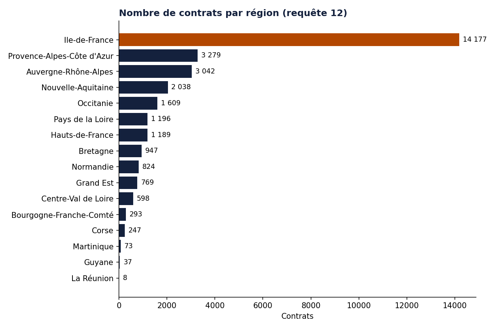
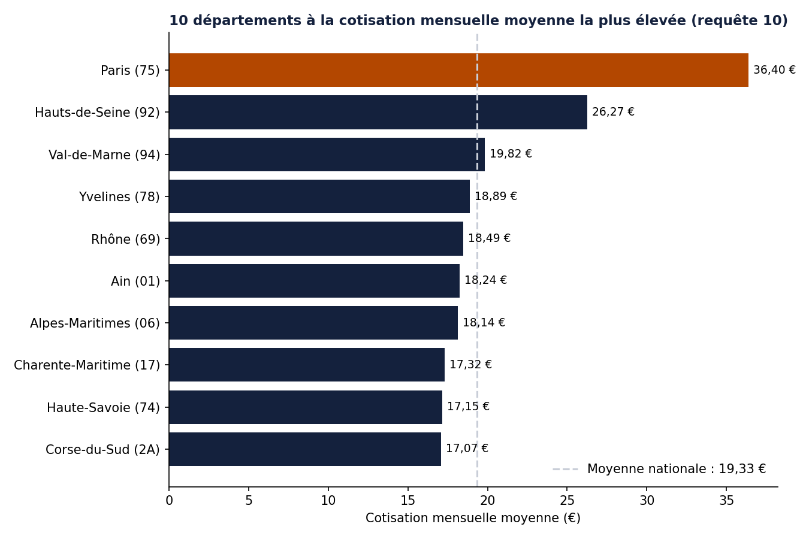
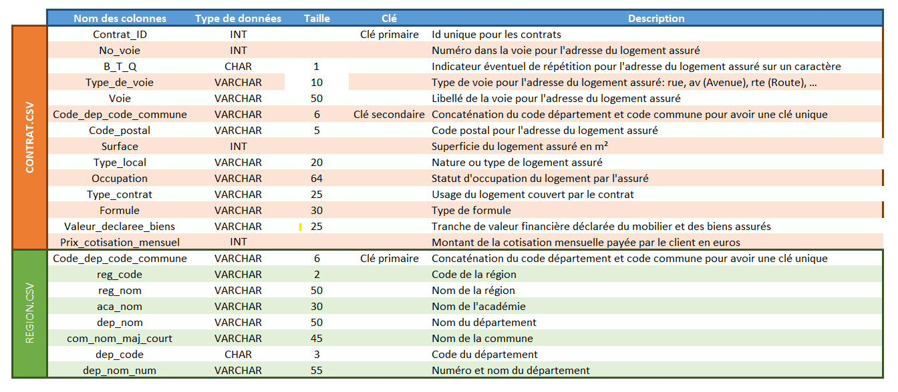
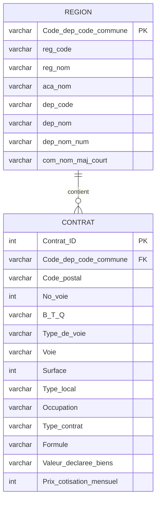
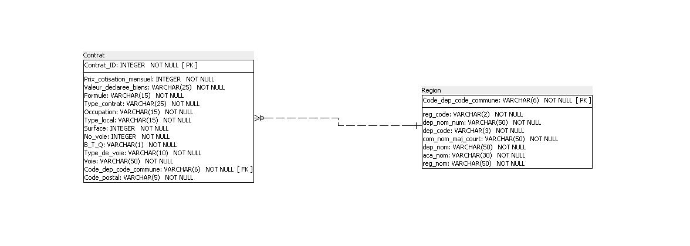
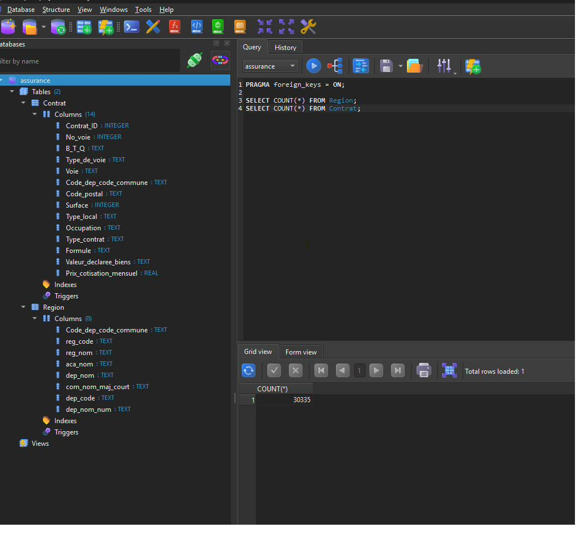
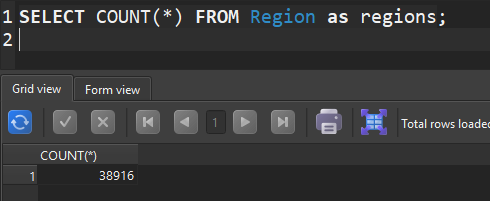
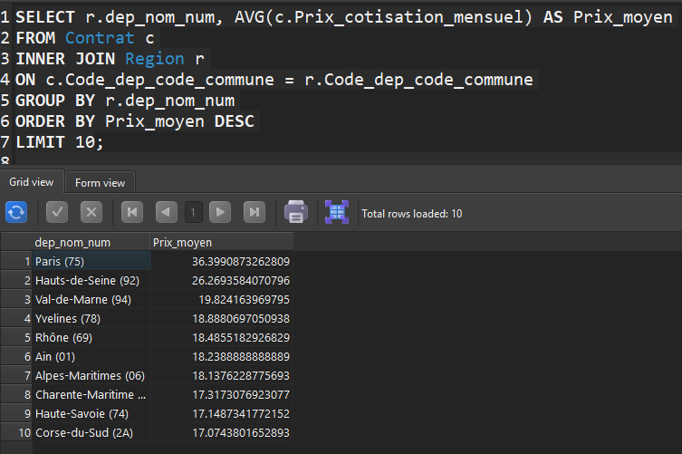
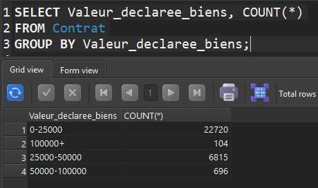

# Analyse du marché de l'assurance habitation avec SQL


> Modéliser, créer et interroger une base de données relationnelle à partir de **30 335 contrats** d'assurance habitation et de **38 916 communes**, puis en tirer des enseignements métier avec **12 requêtes SQL**.

**Sommaire** · [Contexte](#contexte) · [Résultats clés](#résultats-clés) · [Démarche](#démarche) · [Les 12 analyses](#les-12-analyses) · [Qualité des données](#qualité-des-données) · [Reproduire](#reproduire-le-projet) · [Livrables](#livrables) · [Structure](#structure-du-dépôt)

---

## Contexte

Une entreprise d'assurance souhaite mieux accompagner ses clients. Ses données sont dispersées dans deux fichiers CSV : les contrats d'un côté, le référentiel géographique de l'autre. Mon rôle : les structurer dans une base SQL, puis répondre à des questions métier (où sont les contrats, quelles cotisations, quels profils de logement).

Projet réalisé dans le cadre de la formation **Data Analyst** d'OpenClassrooms (cours « Requêtez une base de données avec SQL »).

### Compétences mises en œuvre

| Domaine | Détail |
| --- | --- |
| Exploration de données | Lecture des colonnes, choix des types et tailles, dictionnaire des données |
| Modélisation | Clé primaire, clé étrangère, cardinalités (SQL Power Architect) |
| Base de données | Création et chargement d'une base **SQLite** avec DB Browser for SQLite |
| SQL | `SELECT`, `WHERE`, `DISTINCT`, `ORDER BY`, `LIMIT`, `INNER JOIN`, `COUNT`, `AVG`, `GROUP BY`, `HAVING` |
| Contrôle qualité | Détection d'orphelins, valeurs vides, codes tronqués, valeurs atypiques |
| Restitution | Document technique, liste des analyses, présentation, graphiques Python |

## Résultats clés

- **Un portefeuille concentré en Île-de-France** : 14 177 contrats, soit environ **47 %** du total. Paris représente à lui seul 4 821 contrats (près de 16 %).
- **Paris coûte presque deux fois plus cher** : cotisation mensuelle moyenne de **36,40 €**, contre **19,33 €** pour l'ensemble du portefeuille.
- **Des contrats essentiellement « résidence principale »** : 25 620 contrats, soit environ 84 %.
- **Une valeur de biens assurés plutôt faible** : environ 75 % des contrats sont dans la tranche 0-25 000 €.
- **Logements urbains et petits** : surface moyenne de **51,77 m²** à Paris.





*Graphiques générés avec Python (`scripts/graphiques.py`) à partir des mêmes requêtes que les analyses 10 et 12.*

## Démarche

1. **Dictionnaire des données** : observation de chaque colonne, choix des types, tailles et clés.
2. **Schéma relationnel** : modèle `Contrat` / `Region` et script de création des tables.
3. **Base SQLite** : création de la base `assurance`, chargement des deux CSV et contrôle du nombre de lignes.
4. **Requêtes SQL** : 12 analyses, chacune avec son résultat.

### 1. Dictionnaire des données



| Fichier | Lignes | Colonnes | Contenu |
| --- | --- | --- | --- |
| `Contrat.csv` | 30 335 | 14 | Adresse, surface, type de logement, formule, cotisation |
| `Region.csv` | 38 916 | 8 | Commune, département, académie, région (source : data.gouv.fr) |

### 2. Schéma relationnel

Une commune peut être rattachée à plusieurs contrats. La colonne `Code_dep_code_commune` (concaténation du code département et du code commune) est la clé primaire de `Region` et la clé étrangère de `Contrat`.



Schéma réalisé avec SQL Power Architect :



Le script de création des tables est dans [`sql/01_creation_tables.sql`](sql/01_creation_tables.sql).

### 3. Base de données chargée

La base contient 2 tables : `Contrat` (30 335 lignes) et `Region` (38 916 lignes), soit exactement le nombre de lignes de chaque CSV.

| Table `Contrat` | Table `Region` |
| --- | --- |
|  |  |

## Les 12 analyses

Toutes les requêtes sont dans [`sql/02_requetes.sql`](sql/02_requetes.sql). Le tableau résume la question, le résultat et renvoie vers la capture DB Browser for SQLite.

| # | Question | Résultat | Capture |
| --- | --- | --- | --- |
| 1 | Contrats du code postal 92100 (ID et surface) | 98 contrats | [voir](images/requetes/req01_code_postal_92100.png) |
| 2 | Régions du référentiel | 19 régions | [voir](images/requetes/req02_regions_distinctes.png) |
| 3 | Contrats « Residence principale » | 25 620 | [voir](images/requetes/req03_residences_principales.png) |
| 4 | 5 plus grandes surfaces | de 815 m² (contrat 104211) à 559 m² | [voir](images/requetes/req04_plus_grandes_surfaces.png) |
| 5 | Cotisation mensuelle moyenne | 19,33 € | [voir](images/requetes/req05_cotisation_moyenne.png) |
| 6 | Contrats par tranche de valeur déclarée | 22 720 · 6 815 · 696 · 104 | [voir](images/requetes/req06_tranches_de_valeur.png) |
| 7 | Formule Integral en Pays de la Loire | 589 | [voir](images/requetes/req07_integral_pays_de_la_loire.png) |
| 8 | Maisons du département 71 | 4 contrats | [voir](images/requetes/req08_maisons_departement_71.png) |
| 9 | Contrats et surface moyenne à Paris | 4 821 contrats · 51,77 m² | [voir](images/requetes/req09_surface_moyenne_paris.png) |
| 10 | Top 10 des départements par cotisation moyenne | Paris (75) : 36,40 € | [voir](images/requetes/req10_top10_departements.png) |
| 11 | Communes avec au moins 150 contrats | 20 communes, dont 12 arrondissements parisiens | [voir](images/requetes/req11_communes_150_contrats.png) |
| 12 | Contrats par région | 16 régions · Île-de-France : 14 177 | [voir](images/requetes/req12_contrats_par_region.png) |

### Exemple détaillé : cotisation moyenne par département (analyse 10)

```sql
SELECT r.dep_nom_num, AVG(c.Prix_cotisation_mensuel) AS Prix_moyen
FROM Contrat c
INNER JOIN Region r
ON c.Code_dep_code_commune = r.Code_dep_code_commune
GROUP BY r.dep_nom_num
ORDER BY Prix_moyen DESC
LIMIT 10;
```



### Exemple détaillé : contrats par tranche de valeur (analyse 6)

```sql
SELECT Valeur_declaree_biens, COUNT(*)
FROM Contrat
GROUP BY Valeur_declaree_biens;
```



Sans `GROUP BY`, la requête renvoie une seule ligne : c'est l'agrégat qui produit une ligne par tranche.

## Qualité des données

Le contrôle des données a mis en évidence plusieurs points à connaître avant toute exploitation :

| Constat | Impact |
| --- | --- |
| **9 contrats sans commune** : des communes de La Réunion (97434, 97460, 97470) n'existent pas dans `Region` | Un `INNER JOIN` les exclut : 30 326 contrats par région au lieu de 30 335. Un `LEFT JOIN` les conserverait. |
| **Zéros initiaux perdus** : 1 664 codes postaux à 4 chiffres (`1370` au lieu de `01370`), `dep_code` vaut `1` et non `01` | Filtres à écrire en conséquence ; analyses 1, 8 et 9 non touchées |
| **Valeurs vides** : `No_voie` (122), `B_T_Q` (28 422), `Type_de_voie` (771) | Chaînes vides et non `NULL` : les contraintes `NOT NULL` ne sont pas violées techniquement |
| **Surfaces atypiques** : 24 contrats à 0 m², maximum à 815 m² | Valeurs à vérifier avant toute statistique |

## Choix techniques

- **SQLite plutôt que MySQL** : base portable dans un seul fichier, sans serveur. SQLite applique une affinité de types (`TEXT`, `INTEGER`, `REAL`) et ne contraint pas strictement la taille des `VARCHAR`. Le script généré par SQL Power Architect sert donc de modèle, et les CSV ont été importés directement (l'ordre des colonnes du script diffère de celui des fichiers).
- **Jointure sur une clé unique** : `Code_dep_code_commune` évite les ambiguïtés entre communes homonymes.
- **Pistes d'amélioration** : normaliser `Region` en trois tables (commune, département, région), corriger les codes tronqués à l'import, ajouter des index sur la clé étrangère.

## Reproduire le projet

1. Placer `Contrat.csv` et `Region.csv` dans [`data/`](data/README.md) (séparateur `;`, UTF-8).
2. Ouvrir **DB Browser for SQLite**, créer une base `assurance`.
3. *Fichier > Importer > Table à partir d'un fichier CSV* pour chaque fichier (première ligne = en-têtes), en nommant les tables `Contrat` et `Region`.
4. Exécuter [`sql/02_requetes.sql`](sql/02_requetes.sql) dans l'onglet *Exécuter le SQL*.
5. (Optionnel) Générer les graphiques :

```bash
pip install pandas matplotlib
python scripts/graphiques.py
```

## Livrables

| Livrable | Fichier |
| --- | --- |
| Document technique : dictionnaire, schéma, code SQL, base chargée | [`docs/1_document_technique.pdf`](docs/1_document_technique.pdf) |
| Liste complète des analyses et résultats | [`docs/2_liste_des_analyses.pdf`](docs/2_liste_des_analyses.pdf) |
| Présentation de la méthodologie (10 slides) | [`docs/3_methodologie.pdf`](docs/3_methodologie.pdf) |

## Structure du dépôt

```
projet-sql-assurance-habitation/
├── README.md
├── .gitignore
├── data/                  # CSV sources (non versionnés)
├── docs/                  # livrables PDF
├── images/
│   ├── 01_dictionnaire_donnees.png
│   ├── 02_schema_relationnel.png
│   ├── 03_base_sqlite_*.png
│   ├── graphiques/        # graphiques Python
│   └── requetes/          # captures des 12 requêtes
├── scripts/
│   └── graphiques.py
└── sql/
    ├── 01_creation_tables.sql
    └── 02_requetes.sql
```

## Auteur

**Zid Ahmed Moundji** · [LinkedIn](www.linkedin.com/in/ahmed-moundji-zid-027643207) · [GitHub](https://github.com/VOTRE-PSEUDO)

*Les données sources proviennent du projet pédagogique OpenClassrooms et du référentiel géographique de data.gouv.fr. Elles ne sont pas redistribuées dans ce dépôt.*
